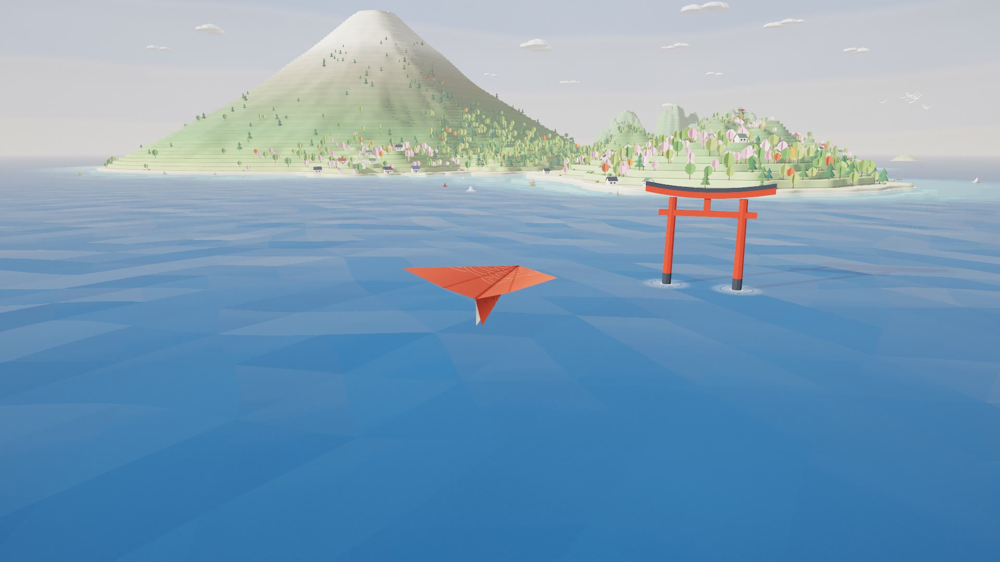
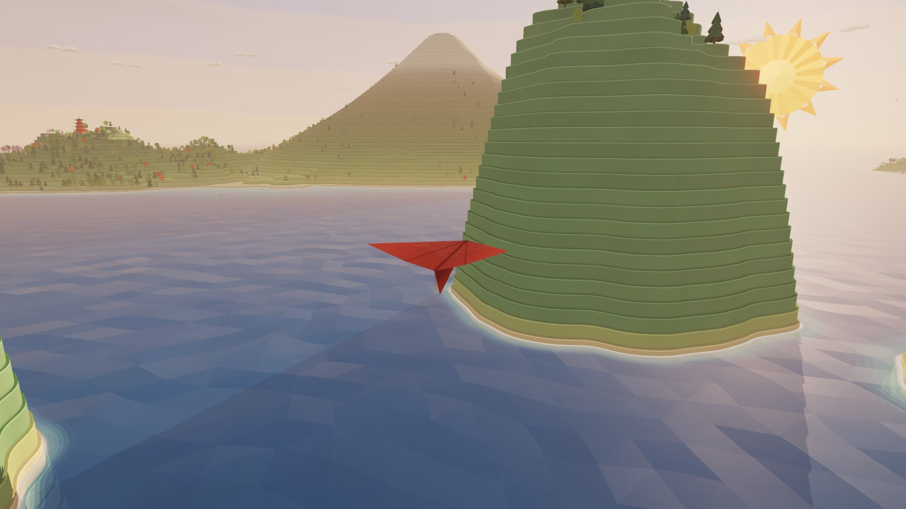
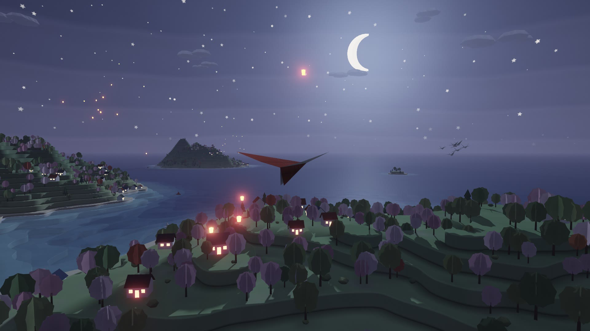
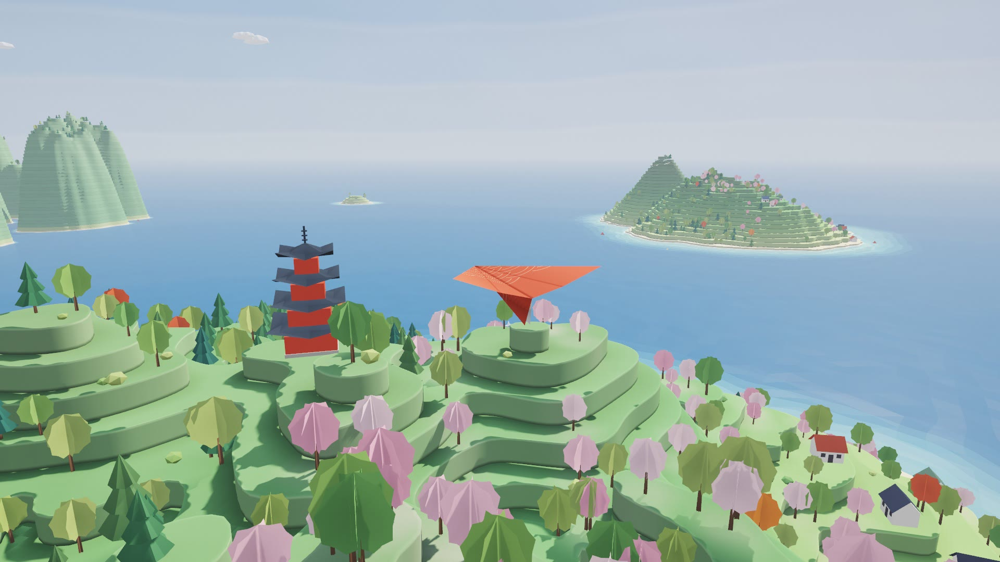
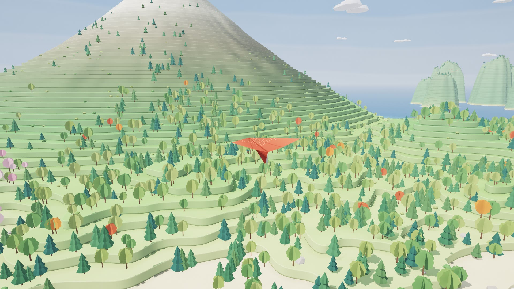
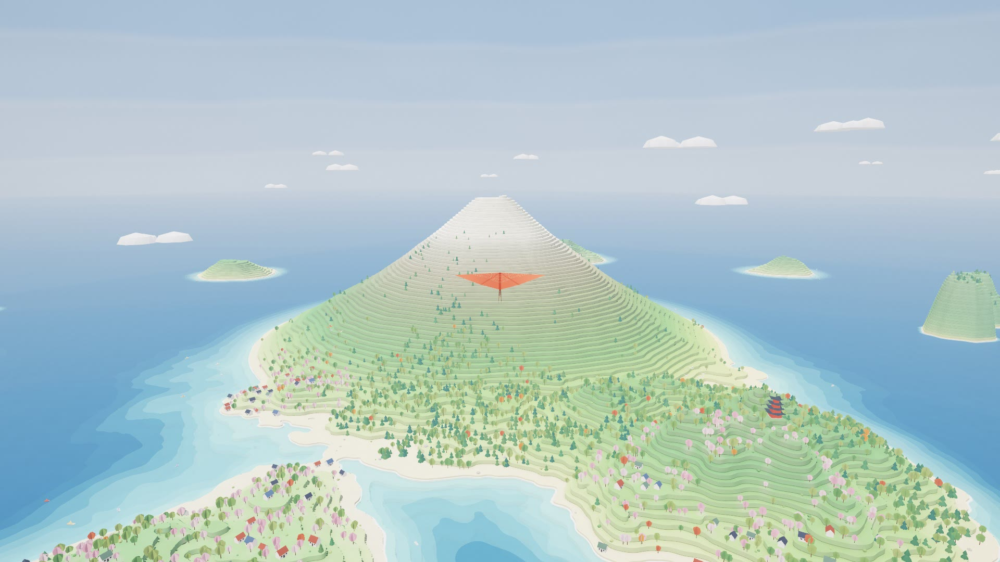

# Paper Skies

**A calm origami world you drift over in a paper plane, right in your browser.**

Islands made of stacked sheets of paper, a translucent paper sea, cherry trees, a pagoda on the hill and a red torii gate standing in the shallows. The sun folds into the sea at dusk, an origami moon rises, and paper lanterns drift up from the villages. Everything you see is made by code: no images, no 3D models. The whole world, music included, fits in **one HTML file of about 3.8 MB** (82 KB of it is the world; the rest is the music).



## Try it

1. Download [`index.html`](index.html).
2. Open it in **Chrome** or **Edge** on a desktop computer.
3. Wait a few seconds while the islands are folded, then choose **Fly** or **Autopilot**.

Nothing to install, and it works offline. It needs a browser with **WebGPU**.

## On a phone

It needs a phone browser with WebGPU: **Chrome on a recent Android phone** (Android 12 or newer), or **Safari on an iPhone or iPad with iOS 26** or newer. Phones start on the Low or Medium detail level, the page turns to landscape, and you steer by touch (see below). It is tested on a desktop only so far, so treat phones as a bonus.

## Two ways to fly

- **Fly**: you steer the plane. It glides on its own, banks into turns, picks up speed in a dive and slows in a climb. Rising ground lifts it gently over each sheet, and far out over the sea a soft wind turns it back toward the islands, so there is nothing to crash into.
- **Autopilot**: the plane wanders by itself, drifting from one place to the next (the mountain, the pillars, the villages, the torii, the pagoda) at a height that slowly rises and falls, on a different route every visit. The camera drifts around it a little. Leave the mouse still for 3 seconds and the cursor and the menu button fade away, so there is only the world. It also flies behind the menu.

The camera always keeps the plane in the middle of the screen.

## What's there

- **Stacked paper land**: every few metres of height is its own sheet with a cut edge and a soft shadow at its foot, from the sandy beaches to the snow at the top of the mountain
- **A paper sea**: layered blue shallows under a sheet of tracing paper folded into slow facets, with a white strip of paper breathing along every shore
- **Karst pillars** rising from the sea in the north-east, a snow-capped cone on the main island, rolling green islets
- **Folded props**: pleated pines, slotted paper-card trees (cherry and maple among them), houses with windows that light up at night, a pagoda with sweeping eaves, a torii gate with slow ripples around its posts, paper boats, flocks of origami cranes and pleated clouds
- **Day and night**: a pleated paper sun crosses the sky and sets into the sea as a crescent moon rises; folded stars come out, and lanterns drift up over the villages and float on the bay
- **Music**: *風の呼吸 (Breath of the Wind)*, a flute piece made with [Suno](https://suno.com), looping without a pause, over a soft bed of wind over the wings, the sea below and birds by day

| | |
|---|---|
|  |  |
|  |  |



## Controls

| | Keyboard & mouse |
|---|---|
| Steer | Move the mouse (click the scene to capture it) |
| Climb · turn | `W` `A` `S` `D` or the arrow keys |
| Gust of wind | Hold `Shift` |
| Fly / autopilot | `Tab` (steering on autopilot also takes the controls) |
| Hurry the time of day | Hold `T` |
| Menu | `Esc` |
| Volume | The slider in the menu (`Esc`); it is remembered |
| Sound on / off | `M` (sound starts when you begin) |
| Performance stats | `H` |

**On a touchscreen:** hold one finger down and slide it to steer; put a second finger down for a gust. The `≡` button opens the menu.

## Detail levels

The **Low**, **Medium** and **High** buttons in the menu pick the detail level (the page reloads). Each level is the same world:

| Level | What it is |
|---|---|
| **High** | Full scene, 4x anti-aliasing, 1.5 m land grid |
| **Medium** | Half of the trees and bushes |
| **Low** | A quarter of them, a 3 m land grid, no anti-aliasing, smaller shadow maps, 480p to start with |

Adding `?lv=0`, `?lv=1` or `?lv=2` to the address (High, Medium, Low) forces a level for that visit without changing what is remembered. If loading crashes the tab or the graphics driver gives up, the page starts again one level lower. The browser remembers the level and the resolution the scene settled on. On slower hardware the resolution adjusts itself to hold 60 fps.

## How it works

- A compute shader shapes the islands on the graphics card when the page opens. The heights are then cut into sheets: flat stretches merge into large squares (with no cracks between them), and the edge of every sheet is traced with marching squares and given a wall one sheet tall.
- Shadows of the land come from a height map that is re-traced toward the sun a band at a time, so they follow the sun and the moon across the day. A second, sharper shadow map follows the plane for the trees, houses, boats and the plane itself.
- Everything is drawn with **WebGPU** directly. No game engine or 3D library is used.
- The music is embedded in the page. It plays whole and loops: when it is decoded, its own fade-out is laid over its opening, so it wraps around without a pause.
- The plane flies on a small fixed-step flight model shared by both modes, so the autopilot and your hands feel the same and you can switch at any moment.
- It's light: about 2 ms of GPU time per frame on average at 2560x1440 on High on an RTX 4060 Ti (2.6 ms at the 99th percentile, 3.2 ms at worst, over a one-minute flight), so it leaves plenty of room on slower hardware.

## Make it your own

The readable source is in the [`source`](source) folder. To change something and rebuild `index.html` you need [Node.js](https://nodejs.org) 18 or newer:

```bash
cd source
npm install
npm run build
```

`npm run build:readable` writes an unminified `index.html`; `npm run build:dev` writes a separate `dev.html` with extra tools: `1`-`6` jump to fixed viewpoints, `F` flies a one-minute autopilot route, `B` runs that route as a benchmark and reports frame and GPU times. `npm run format` and `npm run lint` run Biome. `tools/shoot.mjs` drives Chrome to take screenshots (run it with Windows Node from WSL, or any Node next to Chrome).

| File | What's inside |
|---|---|
| [`source/src/world.js`](source/src/world.js) | The islands, the paper-sheet land, the folded meshes and where the props go. **A good place to start.** |
| [`source/src/shaders.js`](source/src/shaders.js) | The look: paper, sky, sea, land colours, lighting and the final grade (WGSL) |
| [`source/src/sky.js`](source/src/sky.js) | The time of day: the sun and moon paths and the sky colours |
| [`source/src/plane.js`](source/src/plane.js) | The flight model, the autopilot and the chase camera |
| [`source/src/main.js`](source/src/main.js) | The renderer, the frame loop, the controls and the menu |
| [`source/src/audio.js`](source/src/audio.js) | The music loop, the volume, and the wind, sea and birds under the music |
| [`source/music.m4a`](source/music.m4a) | The music (AAC, 96 kbit/s, which every browser can decode), embedded by the build |
| [`source/src/quality.js`](source/src/quality.js) | The detail levels |
| [`source/src/math.js`](source/src/math.js) | Noise, random numbers, world constants and the mesh builder |
| [`source/src/dev.js`](source/src/dev.js) | Development tools, only in `dev.html` |
| [`source/template.html`](source/template.html) | The page around the scene: loading bar, menu and their styles |

Some easy first tweaks:

- **Length of a day:** `CYCLE` in `sky.js`
- **Sky colours through the day:** the `SKYK` table in `sky.js`
- **Land colours:** `layerCol` in `shaders.js`
- **The islands:** the `ISLANDS` list at the top of `world.js`
- **The plane's colour:** `PLANE_COL` in `main.js`
- **The music:** replace `source/music.m4a` (for example `ffmpeg -i song.mp3 -vn -map_metadata -1 -c:a aac -b:a 96k source/music.m4a`) and rebuild; delete it to fly with only the wind and the sea. Its level is `MVOL` in `audio.js`

## Credits

Built on the approach of [Abyssal Garden](https://github.com/Noniv/abyssal-garden); see [THIRD_PARTY_NOTICES.md](THIRD_PARTY_NOTICES.md).
